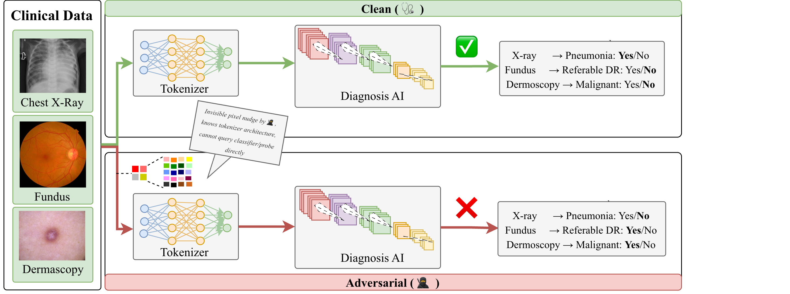

# Adversarial Attacks Expose Path-Dependent Failures in Discrete Medical Image Tokenizers

Code for the paper. Adversarial attacks and defenses against discrete image
tokenizers (VQ-16, FSQ, and the domain-paired ViT-based MedITok / UniTok)
placed ahead of a medical-image classifier, on chest X-ray, fundus, and
dermoscopy.



*Threat model: an adversary who knows the tokenizer architecture but cannot
query the downstream classifier or probe adds an imperceptible pixel-space
perturbation. The same tokenizer yields the correct diagnosis on the clean
image and the wrong one on the perturbed image.*

## Research questions

1. Does a boundary-targeted (Voronoi/grid-wall) attack on the tokenizer's codebook
   beat a global-displacement attack?
2. Does noise injected right before quantization defend better than noise at the
   pixel input?
3. Does token-flip translate to clinically meaningful misclassification, and does
   this generalize across tokenizers and datasets?
4. Are domain-specific tokenizers inherently more robust than general-domain ones?

## Attack names

The repo uses the paper's attack names everywhere -- source, configs, the
`attack` column of every CSV, and the `results/adv_images/<tok>/<attack>/`
directory names:

| id | paper | what it is |
|----|-------|------------|
| `M0` | M0 | direct classifier attack, tokenizer bypassed (reference baseline) |
| `M1` | M1 | tokenizer-mediated supervised attack (task loss through encoder/quantizer/decoder) |
| `M2-sat` | M2-sat | boundary-directed geometric attack, saturating (bounded) once a token flips |
| `M2-unb` | M2-unb | boundary-directed geometric attack, unbounded (keeps displacing past the boundary) |
| `M3_alpha03` | -- | **not used in the paper**: an auxiliary alpha=0.3 blend of the M2 margin objective with M1's BCE loss, retained in the pipeline for completeness |

## Structure

```
src/
  attacks/            attack implementations (per tokenizer): vq16_attacks.py,
                       meditok_unitok_attacks.py, fsq_attacks.py, pgd.py
  defenses/
    common/           generic mechanisms: BPDA, checkpoint merging, CW-L2 attack,
                       decoder-realism training loop -- not tied to any one tokenizer
    vq16/             VQ-16-specific margin/SQS/certification math
    multicodebook/    MediTok/UniTok-specific margin/SQS math (shared codebook geometry)
    fsq/              FSQ-specific margin/SQS/certification math (no codebook --
                       per-dimension scalar quantization, its own geometry throughout)
  tokenizers/         tokenizer loading + reconstruct wrappers (vq16.py, fsq.py,
                       meditok_unitok.py)
  datasets/           dataset loading + splits (kermany.py, aptos.py, isic.py)
  models/             downstream classifier wrappers (DenseNet121, EfficientNet-B4/B5)
  eval/               metrics, probes, bootstrap significance, SEL/REPORT split
scripts/
  attacks/            one orchestration script per (tokenizer, dataset) pair
  defenses/           one directory per (tokenizer, dataset) pair, each holding
                       the full advft/decoder-realism/merge/SQS-sweep/BPDA/geo/CW-L2/
                       certification/final-table pipeline for that pair -- run via
                       run_pipeline.py, not by hand. 4 tokenizers x 3 datasets = 12:
                         vq16_kermany/     vq16_aptos/     vq16_isic/
                         meditok_kermany/  meditok_aptos/  meditok_isic/
                         unitok_kermany/   unitok_aptos/   unitok_isic/
                         fsq_kermany/      fsq_aptos/      fsq_isic/
                       (MediTok and UniTok share one attack-generation pass in
                       scripts/attacks/run_meditok_unitok_{dataset}.py; their
                       defense pipelines are separate directories.)
  diagnostics/        one-off verification/measurement scripts, not part of the main pipeline
  paper/             regenerate the workshop paper's figures/tables from the run CSVs
                       (build_paper_figures.py + check_paper_figures.py)
  run_pipeline.py      single entry point that runs a named stage in the correct order
  setup_third_party.sh clones LlamaGen/MediTok/UniTok/FSQ-pytorch + fetches their checkpoints
configs/              hyperparameters (eps grid, sigma values, etc.), one YAML per dataset
ckpts/                classifier + linear-probe checkpoints (committed directly)
docs/                 data acquisition, checkpoint layout, known limitations
```

**Coverage** (tokenizer x dataset): all four tokenizers (VQ-16, MediTok,
UniTok, FSQ) have a full attack + defense pipeline on all three datasets
(Kermany, APTOS, ISIC) -- 12/12. Attack generation stays combined per
tokenizer family: `scripts/attacks/run_meditok_unitok_{dataset}.py` produces
both MediTok's and UniTok's adversarial images in one pass, while the defense
pipelines are split into separate `meditok_{dataset}/` and `unitok_{dataset}/`
directories. Known caveats are in `docs/known_limitations.md`.

## Setup

```bash
pip install -e .
scripts/setup_third_party.sh   # clones LlamaGen/MediTok/UniTok/FSQ-pytorch + fetches their checkpoints
```

`torch`/`torchvision` install their default (CUDA) wheels via pip; if you need a
specific CUDA/CPU build, install those two first from the
[PyTorch index](https://pytorch.org/get-started/locally/) before `pip install -e .`.

Datasets (Kermany chest X-ray, APTOS, ISIC 2019) are not included; see
`docs/data.md` for acquisition instructions.

## Pretrained checkpoints

The 3 classifier and 12 linear-probe checkpoints are committed directly in
`ckpts/` (no Git LFS). One classifier exceeds GitHub's 100 MB file limit and
ships split, so after cloning run once:

```bash
python scripts/fetch_checkpoints.py
```

See `docs/checkpoints.md` for the layout.

## Reproducing results

Run `scripts/run_pipeline.py --stage <name>` rather than invoking individual
scripts by hand -- it runs each stage's scripts in the order they actually
depend on each other (e.g. `advft` and `decoder_realism` must both finish
before `merge`). See `python scripts/run_pipeline.py --help` for the list of
stages. Split indices aren't pre-checked-in files; each script deterministically
re-derives the same split from the dataset's config (`seed`, `val_frac`, ...),
so nothing needs to ship separately for the split to be reproducible.

### Paper figures and tables

Every data figure and results table in the workshop paper is regenerated from
the run CSVs by `scripts/paper/` -- per float a `.csv` of the numbers, the
`.tex` (complete `tikzpicture` / `tabular`, scaffolding lifted verbatim from the
paper), and that `.tex` compiled to `.pdf` with `pdflatex` (`--no-pdf` skips it):

```bash
python scripts/paper/build_paper_figures.py    # -> results/paper_figures/<name>.{csv,tex,pdf}
python scripts/paper/check_paper_figures.py     # recompute headline cells, compare to the paper
```

The input CSVs are vendored under `results/paper_inputs/` and committed.
`check_paper_figures.py` recomputes the headline cells of each float against the
numbers printed in the paper (all match to <= 0.001 AUC). See
`scripts/paper/README.md` for the float coverage and the two provenance notes.

## Citation

See `CITATION.cff`.

## License

MIT — see `LICENSE`.
